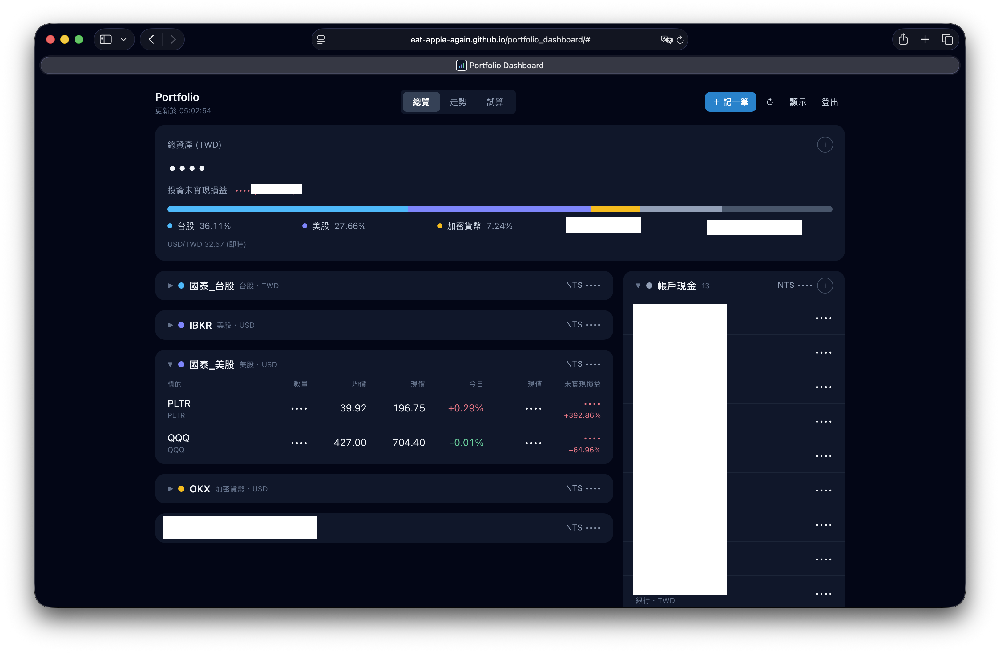
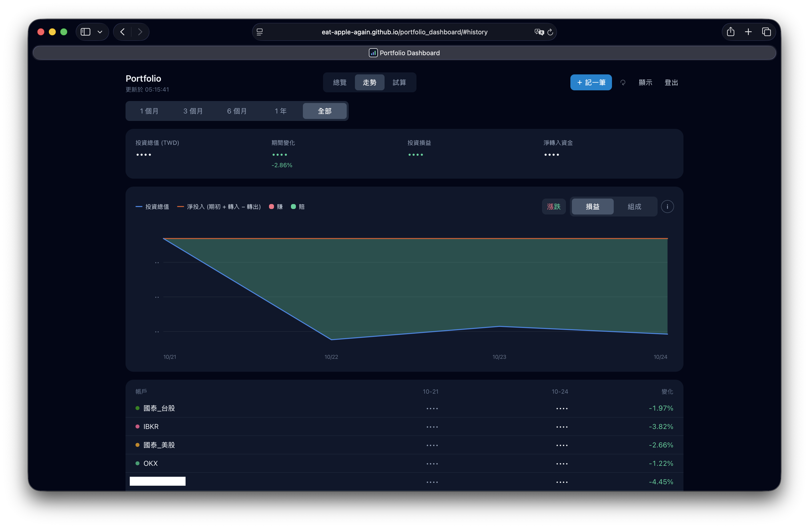
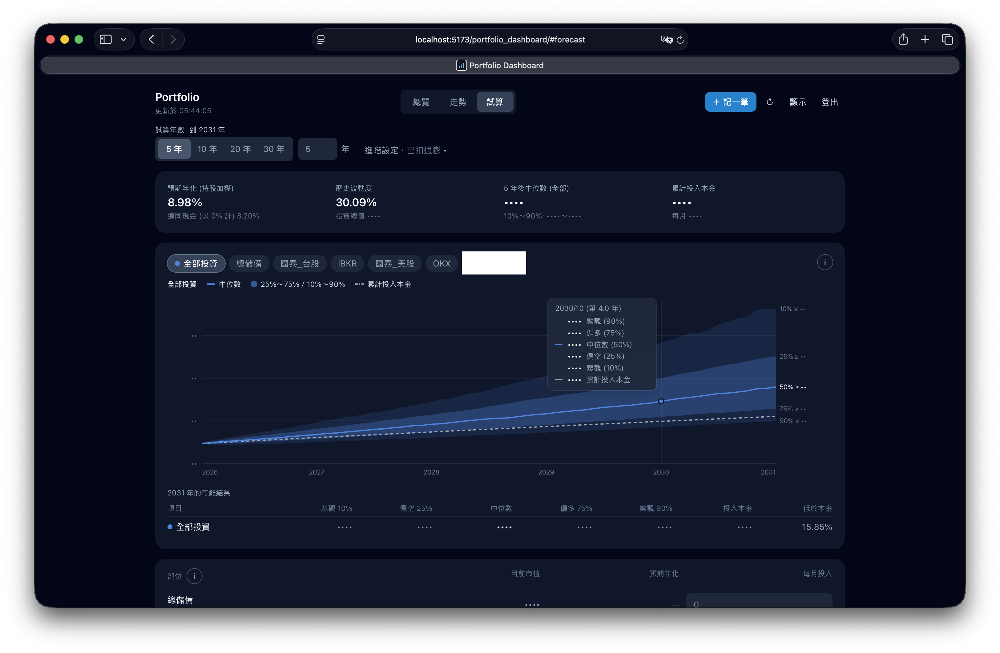

# Portfolio Dashboard

用 **Google Sheets 當資料庫**的個人資產 dashboard。台股、美股、加密貨幣與銀行現金統一換算成 TWD，可在手機上記帳，並提供歷史走勢與未來試算。

- **免伺服器**：前端放 GitHub Pages，後端是你自己 Google 帳號裡的 Apps Script
- **資產不公開**：repo 與網站不含任何資產資料，資料只在你的私人試算表，需 token 才能讀取
- 手機優先、深色主題、可安裝成 App (PWA)

**總覽**：總資產、資產分布、各帳戶持股與現金



**走勢**：投資總值與累計損益



**試算**：未來資產的可能範圍與機率



> 用 AI agent 協助架設？請讓它先讀 [AGENTS.md](AGENTS.md)，裡面有逐步引導與檢查清單。

## 功能

| 頁面 | 內容 |
|---|---|
| **總覽** | 總資產、各帳戶持股與現金、未實現損益、交割款不足提醒 |
| **走勢** | 每日投資總值、累計損益、各部位組成 |
| **試算** | 依預期年化與每月投入，模擬 N 年後的可能結果與機率 |
| **記一筆** | 買進 / 賣出 / 股利、轉帳、收入、支出 |

各區塊右上角的 **ⓘ** 按鈕會說明該功能的計算方式與用法。

## 架設 (約 30 分鐘)

### 1. Fork 並開啟 GitHub Pages

1. 右上角 **Fork** → Create fork
2. 若 repo 名稱不是 `portfolio_dashboard`：修改 [vite.config.ts](vite.config.ts) 的 `base: '/<repo 名稱>/'`
3. **Settings → Pages → Build and deployment → Source** 選 **GitHub Actions**
4. **Actions** 分頁 → 按「I understand my workflows, go ahead and enable them」 (fork 預設停用)
5. 左側選 **Deploy to GitHub Pages** → **Run workflow**
6. 完成後網址為 `https://<GitHub 帳號>.github.io/<repo 名稱>/`

> ⚠️ 同一 GitHub 帳號的所有 Pages 網站共用同一個網域，**其他 Pages 網站不要加入第三方 script**。

### 2. 建立 Google 試算表

新增一份試算表，建立以下分頁，第一列貼上標題 (可直接複製，欄位順序不限)：

| 分頁 | 標題列 |
|---|---|
| `holdings` | `type	symbol	quote_id	name	quantity	avg_cost	currency	account	sheet_price	expected_return	note` |
| `accounts` | `account	type	currency	opening_balance	opening_date	broker	group	note` |
| `trades` | `id	trade_date	account	action	symbol	quantity	price	fee	tax	amount	cash_account	settle_date	note	created_at` |
| `transfers` | `id	datetime	from_account	to_account	amount	to_amount	fee	note	created_at` |
| `presets`(選填) | `kind	note` |

接著填入**起始日**的持股 (`holdings`) 與各帳戶餘額 (`accounts`)，欄位說明見 [試算表欄位](#試算表欄位)。`holdings` 另加一列匯率：`type` = `FX`、`quote_id` = `USDTWD=X`。

### 3. 部署 Apps Script

1. 試算表 **擴充功能 → Apps Script**，貼上 [apps_script/Code.gs](apps_script/Code.gs) 全文並儲存
2. 用密碼管理器產生 32 字元以上的隨機字串作為 token
3. **專案設定 → 指令碼屬性** 新增 `API_TOKEN` = 該 token
4. 編輯器選 `test_run` → 執行 → 授權，紀錄應顯示各分頁筆數
5. **部署 → 新增部署作業 → 網頁應用程式**：執行身分「我」、存取權「所有人」→ 複製 `/exec` 結尾的網址

之後修改 Code.gs 時，用 **管理部署作業 → 編輯 → 新版本** 更新，網址不變。

### 4. 登入

打開網站，輸入 Apps Script 網址與 token。手機可用「加入主畫面」安裝。

## 規劃帳戶

`accounts` 的兩個選填欄位決定帳戶用途：

| 欄位 | 意思 |
|---|---|
| `broker` | 這是哪個持股帳戶的**交割帳戶** (每個持股帳戶一個) |
| `group` | 這筆錢屬於哪個**投資部位**：填持股帳戶名稱 = 待投入現金；填其他名稱 (如 `總儲備`)= 獨立儲備；空白 = 不算投資 |

| 範例 account | type | broker | group |
|---|---|---|---|
| 銀行A (薪轉) | BANK | | `總儲備` |
| 銀行A_預備金 | BANK | | |
| 銀行B_交割 | BANK | `券商_台股` | |
| 銀行C_台幣 (等換匯) | BANK | | `IBKR` |
| IBKR | BROKER | | |

`note` 含「緊急預備金」的帳戶，會在總覽的資產分布中單獨列出。

一個銀行帳戶有兩種用途 (例如投資款與卡費) 時，拆成兩列虛擬帳戶，兩列加總等於銀行餘額。

## 試算表欄位

**holdings** (起始日持股)

| 欄位 | 說明 |
|---|---|
| `type` | `TW_STOCK` / `US_STOCK` / `CRYPTO` / `FX` |
| `quote_id` | 上市 `2330.TW`、上櫃 `6488.TWO`、美股 `VOO`、加密 `BTC-USDT`、匯率 `USDTWD=X` |
| `quantity` / `avg_cost` | 數量與平均成本 (以 `currency` 計價) |
| `currency` | `TWD` / `USD` |
| `account` | 持股所在帳戶 |
| `expected_return` | 試算用預期年化 % (`8` = 8%)，選填 |
| `sheet_price` | 抓不到報價時的備援價，選填 |

**accounts** (起始日現金)：`type` 為 `BANK` / `BROKER` / `EXCHANGE`；`opening_date` 填日期；`broker`、`group` 見上節。

**trades / transfers** 由 App 寫入；記錯時直接在試算表修改或刪除。

## 計算方式

| 項目 | 規則 |
|---|---|
| 現況 | 期初 (`holdings`、`accounts`)+ 之後的交易與轉帳 |
| 持股 / 現金變動 | 持股在成交日、現金在交割日 |
| 平均成本 | 移動平均 |
| 投資損益 | 投資總值變化 − 淨轉入 (薪水、卡費等進出不算損益) |
| 試算 | 以歷史月報酬重抽 2,000 種未來 (bootstrap Monte Carlo)，平均報酬調整為預期年化 |

## 資安

- 資料只在私人試算表；token 存在 Apps Script 指令碼屬性，前端放在 POST body，不出現在網址
- 網址與 token 只存在登入的裝置，「登出」即清除
- 寫入 API 只能新增，每個欄位都會驗證
- 正式版有 CSP，只能連到 Apps Script 與 OKX；不快取 API 回應；`noindex`

## 開發

```bash
npm ci          # 安裝套件 (Node 版本見 .nvmrc)
npm run dev     # http://localhost:5173/portfolio_dashboard/
npm run lint
npm run build
```

## 專案結構

```
apps_script/Code.gs   Apps Script 後端
scripts/test_api.sh   終端機測試 API (只印摘要)
src/lib/              計算邏輯 (replay、走勢、試算)
src/components/       畫面 (說明視窗內容在 info_content.tsx)
AGENTS.md             給 AI agent 的規則與流程
```
